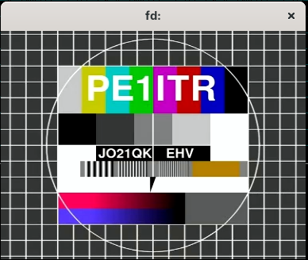
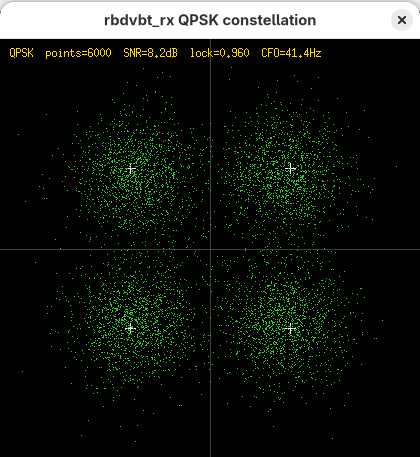
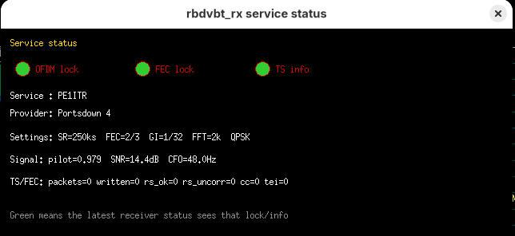
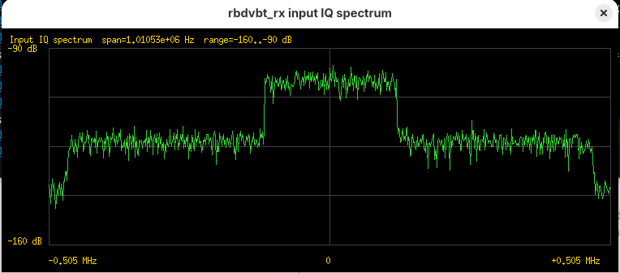
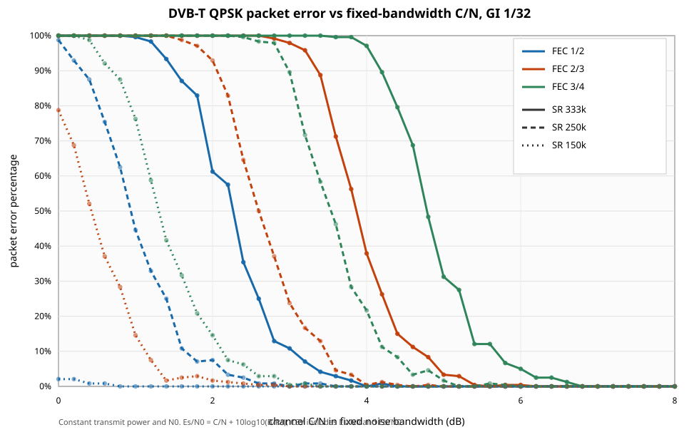
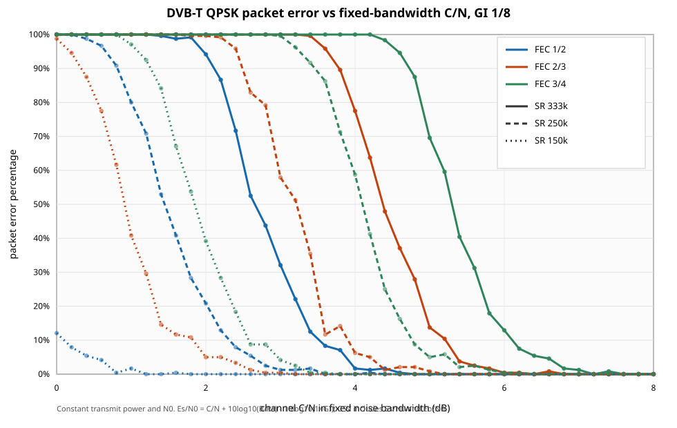

# DVB-T / RTL-SDR

> **Ontwikkelstatus:** De ontwikkeling van deze repository is in principe
> gestopt. De verdere ontwikkeling vindt plaats in
> [sdr-dvb-pipelines](https://github.com/pe1itr/sdr-dvb-pipelines).

Een compacte **Qt6-ontvanger voor reduced-bandwidth DVB-T met RTL-SDR**.
De hoofdvensterindeling volgt `linrad_dvb`: een bedieningsbalk bovenaan,
waterval en spectrum over de volle breedte, en daaronder constellatie links,
ontvangststatus in het midden en video rechts.

De **enige DVB-T-decoderbron** is `sdr-dvb-pipelines/components/dvbt`.
Deze repository bouwt daaruit `rbdvbt_rx` en voegt de RTL-SDR-interface toe.
Er is geen tweede decoderimplementatie of automatische terugval naar de oude
broncode. Decoderontwikkeling blijft in `sdr-dvb-pipelines`.

De GUI ondersteunt uitsluitend RTL-SDR en DVB-T 2K QPSK. De nominale
bandbreedtes zijn 35, 40, 125, 150, 250, 333 en 500 kHz. Ook de modes
35/40/125 kHz zijn uitgebreid getest en standaard onderdeel van `linrad_dvb`.
IQ-bestanden blijven bruikbaar via de decoder-CLI voor tests.

## Snel starten

Zorg dat `sdr-dvb-pipelines` naast deze repository staat (zie Installatie):

```sh
cmake -S . -B build
cmake --build build -j
./build/rbdvbt_gui
```

1. Kies frequentie, gain, bandbreedte, FEC en guard interval.
2. Kies bij **Instellingen** het RTL-SDR device (index of serienummer),
   IQ-samplerate en eventueel ppm-correctie. Standaard: device `0`,
   1.010.526 samples/s, 436 MHz, 333 kHz, FEC 2/3, GI 1/32, gain 30 dB.
3. Druk op **Start ontvangst**. Stop eerst om instellingen te wijzigen.
   Tijdens ontvangst veranderen `←` / `→` de frequentie in stappen van 1 kHz;
   `↑` / `↓` veranderen de RTL-SDR-gain in stappen van 1 dB. De RTL-SDR en
   decoder starten daarbij opnieuw en zoeken daarna opnieuw DVB-T-lock.
4. De video verschijnt via libVLC. **Externe speler** opent VLC op de aparte
   UDP-uitgang, standaard `udp://@:10000`. Video ontbreken verhindert geen
   ontvangst of externe TS-uitvoer. **Diagnose** toont procesmeldingen.

Gain `Auto` gebruikt de automatische gain van `rtl_sdr`. Handmatige gain wordt
door de tuner naar een ondersteunde waarde afgerond. De GUI valideert de
RTL-samplerate en of de gekozen DVB-T-bandbreedte daarin past. Instellingen
worden lokaal opgeslagen met QSettings; de ontvanger start nooit automatisch.
Bij ontbrekende hardware of een gestopt proces stopt de hele ontvangstketen.
Verouderde status en constellaties worden gewist; een oude lock blijft niet
als actuele ontvangst staan.

## Praktijktests

In praktijkproeven met BATC Portsdown 3 en Portsdown 4 zenders is `rbdvbt_rx`
gebruikt met `150k`, `250k` en `333k` modes en FEC `1/2` en `2/3`. Tijdens
tests met PA3BYV op `436 MHz` draaide de ontvanger op een laptop achter een
Netstream uit Linrad DSP met Afedri hardware; daarbij zijn succesvolle decodes
behaald op `150k` en `250k` met FEC `1/2`, ook tijdens een aircraft-scatter
moment. De software is daarnaast getest op een ARM64 Odroid N2 systeem zoals
gebruikt bij de PI6EHV WebSDR en ATV-repeater, en met een `2324 MHz` link naar
de PI6EHV ATV-repeater zijn stabiele streams gerealiseerd voor `250k` en
`333k` met FEC `2/3`.

Ook de smalle DVB-T-modes zijn in de praktijk getest. Tijdens de
[40 kHz DVB-T-proef vanuit Luxemburg op 4 november 2026](https://pe1itr.com/144mhz/144mhz-40khz-dvb-t-experiment-luxembourg-2026.htm)
ontvingen PA0T, PA3BYV en PE1BBI de uitzending van LX/PE1ITR op 144,600 MHz
met RTL-SDR en de Windows-software uit **deze repository**. Er werd beeld
gedecodeerd over afstanden tot 377 km, met QPSK, FEC `1/2` en GI `1/32`.
`linrad_dvb` was tijdens die proef nog niet beschikbaar.



## Doel

De primaire use-case is:

```text
SDR ontvanger of IQ opname -> raw complex IQ -> rbdvbt_rx -> MPEG-TS -> ffplay/VLC
```

De SDR-kant blijft buiten de decoderbinary; de Qt6-interface start daarvoor `rtl_sdr`. Een tool zoals `rtl_sdr`,
SoapySDR, GNU Radio, SDRangel, `hackrf_transfer` of een eigen captureprogramma
kan IQ samples leveren; `rbdvbt_rx` verwacht die samples op `stdin`.

Belangrijke ontwerpkeuzes:

- `stdout` is schoon en bevat alleen MPEG-TS wanneer `--stdout-ts` of
  `--ts-out -` wordt gebruikt.
- Diagnostiek en voortgang gaan naar `stderr`.
- De ontvanger accepteert expliciete DVB-T parameters; TPS-autodetectie is nog
  geen onderdeel van de lock-keten.
- De status kan periodiek als JSON worden geschreven voor monitoring in een
  tweede terminal.
- De decoder is een backend die door de Qt6-interface wordt gestart en bewaakt. High-speed DVB-T hardwaredecode en
  DVB-S/S2 horen daarbij in aparte backends, niet in deze reduced-bandwidth
  softwaredecoder.

## Installatie

Benodigd voor de volledige interface:

- CMake 3.16+, C11-compiler en C++17-compiler voor Qt6 (helpers blijven C++11).
- `pkg-config`, FFTW3 single precision en pthreads.
- Op Linux: GLib development-bestanden voor de headless SRT-uitgang
  (`RBDVBT_BUILD_SRT=ON`, standaard aan). FFmpeg met libsrt en libx264 is
  nodig bij gebruik van SRT. Zonder SRT bouwen: `-DRBDVBT_BUILD_SRT=OFF`.
- Qt6 Widgets, Network en Test (Test is alleen nodig met `BUILD_TESTING=ON`).
- Python 3 voor de Linux buildscript- en SRT-integratietests met `BUILD_TESTING=ON`.
- `rtl_sdr` en toegang tot de RTL-SDR USB-ontvanger.
- Optioneel libVLC development-bestanden en VLC-plugins voor video/audio in
  het venster; VLC als losse speler werkt ook zonder ingebouwde libVLC.
- De broncheckout van `sdr-dvb-pipelines`, standaard in de naastliggende map.

Als die checkout nog ontbreekt, voer vanuit deze repository uit:

```sh
git clone https://github.com/pe1itr/sdr-dvb-pipelines.git ../sdr-dvb-pipelines
```

Gevalideerde decoderrevisie voor deze ombouw:
`0f9665321ae70f39e01c8ef84ebdef2b802f89bd`.
CMake bouwt de aanwezige bronbestanden rechtstreeks; het downloadt of wijzigt
niets in die checkout. Je hoeft de overige ontvangers of de GTK-interface
van `sdr-dvb-pipelines` niet te bouwen. Voor reproduceerbare builds gebruik je
een checkout van die revisie voor de decoder. De SRT-bewaker vereist daarnaast
`src/srt_output.c` en `src/process_control.h` uit een recente checkout
met SRT-ondersteuning; latere wijzigingen daarin worden bij een volgende build
meegenomen.

Op Debian/Ubuntu zijn de GUI-afhankelijkheden bijvoorbeeld:

```sh
sudo apt install build-essential cmake pkg-config libfftw3-dev libglib2.0-dev qt6-base-dev rtl-sdr libvlc-dev vlc ffmpeg
cmake -S . -B build
cmake --build build -j
ctest --test-dir build --output-on-failure
./build/rbdvbt_gui
```

Een andere locatie voor de gedeelde decoder:

```sh
cmake -S . -B build -DRBDVBT_DECODER_ROOT=/pad/naar/sdr-dvb-pipelines/components/dvbt
```

Alleen de decoder en commandlinehulpmiddelen bouwen, zonder Qt6:

```sh
cmake -S . -B build-headless -DRBDVBT_BUILD_GUI=OFF
cmake --build build-headless -j
```

De Odroid-build (`tools-pi6ehv/build_odroid_arm64.sh`) kiest headless zonder
Qt6 en X11, `Release` en standaard twee parallelle buildtaken. Op ARM64 kiest
het script `RBDVBT_TARGET_CPU=odroid-n2`: `-march=armv8-a` met
`-mtune=cortex-a73.cortex-a53`, gelijk aan de upstream N2-build. Deze
[GCC-afstemming](https://gcc.gnu.org/onlinedocs/gcc/AArch64-Options.html)
past bij de A73/A53-combinatie en gebruikt de ARMv8-A-instructieset op beide
soorten cores. Er is geen `fast-math` toegevoegd. CMake controleert of target
en compiler het profiel ondersteunen. De gewone CMake-build blijft `generic`.

Native op de ODROID-N2/N2+ met een 64-bit OS en GCC:

```sh
INSTALL_DEPS=1 RUN_TESTS=1 tools-pi6ehv/build_odroid_arm64.sh
```

Voor volgende builds zijn `INSTALL_DEPS=1` en package-installatie niet nodig.
De decodercheckout blijft wel nodig. `TARGET_CPU=generic` schakelt de
N2-afstemming uit; `WITH_X11=1` bouwt de optionele decoderdiagnostiek mee.
Rechtstreeks met CMake:

```sh
cmake -S . -B build-n2 -DCMAKE_BUILD_TYPE=Release \
  -DRBDVBT_BUILD_GUI=OFF -DRBDVBT_WITH_X11=OFF \
  -DRBDVBT_TARGET_CPU=odroid-n2
cmake --build build-n2 -j2
ctest --test-dir build-n2 --output-on-failure
```

De gedeelde decoder bevat al automatische NEON-Viterbi op ARM64, FFT-hergebruik
bij pilotacquisitie en vooraf berekende draaggolftabellen. Met `RUN_TESTS=1`
wordt op ARM64 ook de upstream NEON-test uitgevoerd: 100.000 gevallen met
6,4 miljoen exacte metricvergelijkingen, survivorbits en best-state-keuzes. Streaming-FEC wordt
met automatische SIMD, geforceerd scalar en zonder expliciete SIMD-kernels
getest. Voor vergelijking tijdens ontvangst kiest
`LINRAD_DVBT_VITERBI_SCALAR=1` de scalar-route; laat die variabele normaal weg.
Met `LOGLEVEL=info` is `kernel=neon-float` zichtbaar wanneer Viterbi actief wordt.
Een native N2-duurtest blijft nodig om de totale belasting inclusief
1080p-encoding, temperatuur en eventuele IQ/FEC-verliezen te beoordelen.

Video in het venster gebruikt libVLC op Windows of Linux/X11. Op een
Wayland-desktop kan de GUI via XWayland draaien:

```sh
QT_QPA_PLATFORM=xcb ./build/rbdvbt_gui
```

Bij native Wayland of een build zonder libVLC gebruik je **Externe speler**.
De decoder schrijft beide TS-kopieën onafhankelijk; het sluiten van een losse
speler stopt de ontvangst niet. Spectrum en constellatie gebruiken een lokale,
automatisch toegewezen UDP-poort. De ingebouwde video krijgt eveneens een
eigen poort; alleen de externe poort is configureerbaar en standaard 10000.

Belangrijkste binaries:

```text
build/rbdvbt_gui            Qt6 RTL-SDR interface
build/rbdvbt_rx             decoder uit sdr-dvb-pipelines
build/rbdvbt_status_watch   terminalmonitor voor status JSON
build/iq_replay_rate        IQ-bestand realtime naar stdout
build/dvbt_fec_snr_plot     performancegrafieken
build/portsdown_iq_dump     synthetisch DVB-T IQ (optionele Portsdown-bron nodig)
build/iq_airscatter_channel aircraft-scattermodel voor s16 IQ
```

Dezelfde Qt6-interface is bedoeld voor Linux en Windows; download de
[Windows 0.2.0 pre-release](https://github.com/pe1itr/dvbt-rx/releases/tag/v0.2.0)
en zie `README_WINDOWS_GUI.txt` voor de Windows-build en runtimebestanden. Deze
ombouw is op Linux en voor Windows x64 gebouwd en onder Wine getest. Live
RTL-SDR-praktijktests moeten nog op de betreffende systemen worden uitgevoerd.

## Basisgebruik

`rbdvbt_rx` leest geen RF-hardware rechtstreeks uit. Gebruik een SDR-programma
of een eerder opgenomen IQ-bestand en pipe of redirect de raw IQ data naar
`stdin`.

Voor een IQ-bestand met interleaved signed 16-bit IQ:

```sh
./build/rbdvbt_rx \
  --probe-constellation \
  --resample-to-dvbt-rate \
  --dvbt-ir 1 \
  --stdin \
  --input-format s16 \
  --sample-rate 1010526 \
  --sr 333k \
  --gi auto \
  --fec auto \
  --stdout-ts \
  < recordings/dvbt-333k-g32-20260322.iq | ffplay -
```

Naar een TS-bestand schrijven:

```sh
./build/rbdvbt_rx \
  --probe-constellation \
  --resample-to-dvbt-rate \
  --dvbt-ir 1 \
  --stdin \
  --input-format s16 \
  --sample-rate 1010526 \
  --sr 333k \
  --gi 1/32 \
  --fec 2/3 \
  --ts-out recovered.ts \
  < capture.iq
```

Een IQ-bestand als realtime SDR-stream naar de live decoder voeren:

```sh
./build/iq_replay_rate \
  --in recordings/linrad_20260516_222622_s16.iq \
  --input-format s16 \
  --sample-rate 1010526 |
./build/rbdvbt_rx \
  --probe-constellation \
  --resample-to-dvbt-rate \
  --dvbt-ir 1 \
  --stdin \
  --input-format s16 \
  --sample-rate 1010526 \
  --sr 250k \
  --gi 1/32 \
  --fec 1/2 \
  --live \
  --live-symbols 64 \
  --probe-symbols 64 \
  --ts-out recovered-250k.ts
```

Gebruik voor `150k` normaal `--sr 150k --live-symbols 128 --probe-symbols 128`.
`iq_replay_rate` schrijft alleen IQ-bytes naar `stdout`; voortgang gaat naar
`stderr`, zodat de pipe naar `rbdvbt_rx` schoon blijft.

Met status JSON:

```sh
./build/rbdvbt_rx \
  --probe-constellation \
  --resample-to-dvbt-rate \
  --dvbt-ir 1 \
  --stdin \
  --input-format s16 \
  --sample-rate 1010526 \
  --sr 333k \
  --gi 1/32 \
  --fec 2/3 \
  --stdout-ts \
  --status-json /tmp/rx_status.json \
  --status-period-packets 50 \
  < capture.iq | ffplay -
```

Naar VLC of ffplay via UDP sturen, handig op Windows waar stdout-pipes naar
VLC lastig kunnen zijn:

```sh
./build/rbdvbt_rx \
  --probe-constellation \
  --resample-to-dvbt-rate \
  --dvbt-ir 1 \
  --stdin \
  --input-format u8 \
  --sample-rate 1010526 \
  --sr 250k \
  --gi 1/32 \
  --fec 2/3 \
  --udp-ts 127.0.0.1:10000 \
  --wait-video-start \
  < capture.iq
```

Open in VLC: `udp://@:10000`. Met ffplay kan dit met
`ffplay -f mpegts udp://127.0.0.1:10000`.
Gebruik `--udp-copy 127.0.0.1:10002` wanneer dezelfde transportstream ook naar
een tweede lokale ontvanger moet.

Aircraft-scatter looptest met 200/300/400 km, crossing-hoeken 30/70 graden,
symbolrates 150k/250k/333k en SNR 3..9 dB:

```sh
TS_PATH=other_parties/portsdown4/video/SR333_FEC2-3_S2_Test.ts \
  FEC=1/2 GI=1/32 tools/run_airscatter_looptest.sh
```

De looptest maakt eerst een schoon Portsdown-achtig IQ-bestand, genereert per
scenario aircraft-scatter metadata met het model in
`/home/rhardenb/repo-prop/airplanescatter`, past delay, Doppler, path-ratio,
notches en AWGN toe, en draait daarna `rbdvbt_rx` op elk vervormd IQ-bestand.
Gebruik hierbij altijd expliciete DVB-T parameters: `FEC=auto` en `GI=auto`
worden door de looptest geweigerd, omdat de praktijkrun ook met opgegeven
instellingen werkt en daarmee sneller lockt.
Standaard gebruikt de kanaalstap `PATH_RATIO_OFFSET_DB=-10` om de direct- en
aircraft-paden dichter bij gelijke amplitude te brengen; dat maakt de notch-test
strenger. De resultaten staan standaard onder
`/tmp/rbdvbt-airscatter-loop/summary.csv`.
Naast `ts_bytes` bevat de summary per run ook decoder-metrics uit de log:
frontend-lock/SNR, live chunk-resultaten, outer acquisition/relock/degrade
tellingen, RS-correcties/uncorrectables en TS-fouten. Gebruik die kolommen voor
praktijktesten waar een run wel frontend-lock heeft maar nog geen bruikbare
outer/FEC-output levert.
Als `TS_PATH` niet gezet is, gebruikt de generator null-packets; dat is nuttig
voor frontend/FEC-logmetrics, maar niet voor `ts_bytes` als succesmetric.
Gegenereerde impaired IQ-bestanden worden standaard na elke decode verwijderd;
gebruik `KEEP_IMPAIRED_IQ=1` om ze te bewaren.

De scenario-span is standaard `TEST_DURATION_S=40` seconden rond de passagepiek.
Voor een snelle subset:

```sh
SR_LIST="250k" SNR_LIST="7 8" DISTANCE_LIST="300" CROSSING_LIST="70" \
  TEST_DURATION_S=40 TS_PATH=other_parties/portsdown4/video/SR333_FEC2-3_S2_Test.ts \
  FEC=1/2 GI=1/32 tools/run_airscatter_looptest.sh
```

Status bekijken in een tweede terminal:

```sh
./build/rbdvbt_status_watch /tmp/rx_status.json
```

## Live Ontvangst

Gebruik `--live` voor een doorlopende IQ-stream van een SDR-frontend. In deze
modus verwerkt de ontvanger stdin in opeenvolgende OFDM-chunks, houdt een
kleine FIFO tussen frontend en inner/outer decoder bij, en probeert na een
frontend-discontinuity of zwakke chunk opnieuw te locken zonder het proces te
stoppen. MPEG-TS blijft schoon op `stdout` wanneer `--stdout-ts` of
`--ts-out -` wordt gebruikt; alle timing-, FIFO- en lockinformatie gaat naar
`stderr`. Live decoding laat marginale chunks met zwakke pilot-lock vallen
voordat ze de Viterbi/outer FEC state kunnen vervuilen; de status kan daarbij
nog steeds OFDM-sync tonen terwijl de transportstream tijdelijk opnieuw
acquiret.

Een live run die is getest met een Linrad/SDR stream op `1010526 Hz` sample
rate:

```sh
./build/rbdvbt_rx \
  --probe-constellation \
  --resample-to-dvbt-rate \
  --dvbt-ir 1 \
  --stdin \
  --input-format s16 \
  --sample-rate 1010526 \
  --sr 250k \
  --gi 1/32 \
  --fec 2/3 \
  --live \
  --live-symbols 64 \
  --gui \
  --ts-out - | ffplay -
```

Met deze live sample-rate stream is `250k`, FEC `2/3`, GI `1/32` getest met
stabiele pilot-lock, `rs_uncorr=0`, `cc=0` en geen FIFO-drops. Na de 64-state
Viterbi optimalisatie ligt de Viterbi-tijd voor 64-symbol chunks typisch rond
`0.125-0.127 s` op deze testopstelling.

Live Viterbi timing wordt uitgesplitst in `stderr` als `viterbi-detail`, met
velden voor `depuncture`, `acs`, `traceback`, `pack`, `outer` en `total`. Voor
regressietests tussen twee binaries kan dezelfde IQ-capture worden vergeleken:

```sh
tools/compare_viterbi_decoders.sh ./old/rbdvbt_rx ./build/rbdvbt_rx \
  --input capture.s16 -- --stdin --input-format s16 --sample-rate 1010526 \
  --sr 333k --gi 1/32 --fec 2/3 --live --probe-constellation \
  --resample-to-dvbt-rate --dvbt-ir 1 --ts-out -
```

### RTL-SDR naar SRT

Voor een Odroid of andere Linux ontvanger staat er een opstartscript dat de
geteste pipeline combineert:

```text
rtl_sdr -> rbdvbt_rx -> MPEG-TS UDP :10000 -> rbdvbt_srt -> ffmpeg -> SRT
```

Standaard gebruikt het script `436000000 Hz`, RTL-SDR device `00000001`,
sample-rate `1010526`, symbolrate `333000`, gain `30`, FEC `2/3`, GI `1/32`
en stuurt het naar
`srt://44.137.26.85:4001?mode=caller&latency=500000`:

```sh
tools-pi6ehv/dvbt_rx_pi6ehv.sh
```

De belangrijkste instellingen zijn via environment variabelen aan te passen:

```sh
SRT_URL='srt://44.137.26.85:4001?mode=caller&latency=500000' \
FREQUENCY=436000000 \
RTL_DEVICE=00000001 \
SAMPLERATE=1010526 \
SYMBOLRATE=333000 \
GAIN=30 \
FEC=2/3 \
GI=1/32 \
tools-pi6ehv/dvbt_rx_pi6ehv.sh
```

Als ffmpeg niet in `PATH` staat:

```sh
FFMPEG=../ffmpeg/ffmpeg tools-pi6ehv/dvbt_rx_pi6ehv.sh
```

Het script draait standaard headless. `rbdvbt_srt` bouwt rechtstreeks dezelfde
SRT-bewaker als `linrad_dvb` uit `sdr-dvb-pipelines`; er is geen aparte kopie.
Zonder video blijft de ontvanger draaien zonder SRT-verbinding. Zodra
voortschrijdende videopayload binnenkomt, start de bewaker FFmpeg en de
SRT-caller. Na standaard 2000 ms zonder videopayload stopt FFmpeg en wordt SRT
verbroken. Bij nieuwe ontvangst start de uitgang vanzelf opnieuw. Alleen PSI,
null-pakketten, herhaalde continuity counters of pakketten met transportfouten
houden de uitgang niet open. Dit is dezelfde videopayload-detectie als in
`linrad_dvb`; de bewaker controleert geen daadwerkelijk gedecodeerde frames.

De uitvoer volgt ook precies `linrad_dvb`: **1920×1080p25 H.264**, standaard
4000 kbit/s, preset `veryfast`, en optionele audio als AAC stereo 48 kHz,
128 kbit/s. Interlaced beeld wordt gedeïnterlaced. De bronbeeldverhouding,
inclusief anamorfische pixels, blijft behouden met vierkante uitvoerpixels en
zwarte balken. De resolutie staat vast op Full HD; fps, bitrate, preset en
threads zijn instelbaar:

| Environmentvariabele | Default | Betekenis |
|---|---|---|
| `SRT_LOSS_TIMEOUT_MS` | `2000` | Zonder video na deze tijd SRT verbreken |
| `SRT_RETRY_INTERVAL_MS` | `2000` | Nieuwe poging na uitgangsfout zolang video binnenkomt |
| `SRT_FPS` | `25` | Uitvoerframerate, 1–60 |
| `SRT_VIDEO_BITRATE_KBPS` | `4000` | H.264-bitrate, 100–50000 kbit/s |
| `SRT_X264_PRESET` | `veryfast` | x264-preset |
| `SRT_VIDEO_THREADS` | `0` | Threads per decoder/encoderpool, 0=automatisch |
| `SRT_FILTER_THREADS` | `0` | Filterthreads, 0=automatisch |

Het script herkent een ODROID-N2/N2+ via `/proc/device-tree/model` en kiest
dan automatisch het upstream N2-startpunt: `ultrafast`, drie videothreads en
één filterthread. Op andere machines blijven `veryfast` en automatische
threadaantallen gelden. Je kunt de profielkeuze expliciet maken:

```sh
SRT_PROFILE=odroid-n2 tools-pi6ehv/dvbt_rx_pi6ehv.sh
```

`SRT_PROFILE=generic` schakelt de N2-voorkeuren uit. Expliciete
`SRT_X264_PRESET`, `SRT_VIDEO_THREADS` en `SRT_FILTER_THREADS` gaan voor het
profiel. Threadaantallen gelden per decoder/encoder/filterpool, niet als totaal.

De vroegere `FFMPEG_SCALE`, `FFMPEG_AUDIO`, `FFMPEG_MAP` en
`FFMPEG_VIDEO_*`-instellingen zijn vervangen door bovenstaande vaste
Full HD H.264/AAC-route en `SRT_*`-instellingen.

De interne TS-route blijft standaard `UDP_TS=127.0.0.1:10000`.
De bewaker blijft die UDP-ingang uitlezen als FFmpeg of de SRT-server vastloopt;
een begrensde wachtrij voorkomt dat de ontvanger op de uitgang moet wachten.
Met `UDP_TS=off` werkt ook MPEG-TS via stdout/FIFO. Receiver-diagnostiek gaat
naar `logs/rx_YYYYmmdd_HHMMSS.log`, status JSON standaard naar
`/var/www/html/dvb/dvbt-rx-status.json`. Zet `GUI=1` voor de X11-diagnostiek.
SRT/FFmpeg-diagnostiek staat tijdelijk onder `/tmp`; kies `FFMPEGLOG=/pad/log`
om die te bewaren. Receiverlogs worden beperkt met `LOG_KEEP`.

Ontvangstverlies herstart de ontvanger niet meer: de uitgang regelt dit zelf.
De watchdog bewaakt alleen vastgelopen statusupdates na een eerste lock
(`STATUS_STALE_TIMEOUT`, standaard 30 s). De oude `LOCK_LOSS_TIMEOUT` en
`FFMPEG_NO_FRAME_LIMIT` vervallen.

De bewaker kan ook los bij een al draaiende ontvanger worden gestart.
Geef de ontvanger daarvoor `--udp-ts 127.0.0.1:10000` mee en start:

```sh
./build/rbdvbt_srt --udp-input 127.0.0.1:10000 \
  --url 'srt://44.137.26.85:4001?mode=caller&latency=500000' \
  --ffmpeg ../ffmpeg/ffmpeg --fps 25 --bitrate-kbps 4000
```

Deze opdracht ontvangt MPEG-TS via UDP en verstuurt H.264/AAC via SRT; stdout
blijft leeg. Zonder `--udp-input` leest de bewaker MPEG-TS op stdin.
Gebruik `./build/rbdvbt_srt --help` voor alle bewakeropties.

De losse webpagina `tools-pi6ehv/dvbt-rx-status.html` leest die JSON via
`dvb/dvbt-rx-status.json`. Plaats de pagina op de webroot van de Odroid,
bijvoorbeeld als `/var/www/html/dvbt-rx-status.html`.

### Decoderdiagnostiek via X11

Met `--gui` toont de ontvanger live X11-vensters voor de belangrijkste
ontvangstinformatie: QPSK-constellatie, service/status en het spectrum van de
inkomende IQ-stream. Het spectrumvenster gebruikt de raw IQ-samples aan de
ingang van de ontvanger; de x-as loopt over de volledige sample-rate span en de
y-as toont het niveau in dB.

Voor externe launchers, zoals de Windows Qt GUI, is er daarnaast
`--visualizer-udp IPv4:PORT`. Die optie staat standaard uit en stuurt alleen
best-effort binaire spectrum- en constellatieframes via UDP; `--gui` blijft de
Linux/X11 vensterinterface.







## Parameters

### Invoer

| Parameter | Betekenis |
|---|---|
| `--stdin` | Lees IQ van standaardinvoer. Verplicht. |
| `--input-format s16` | Interleaved signed 16-bit little-endian IQ. Dit is de default wanneer `--input-format` wordt weggelaten. |
| `--input-format u8` | Interleaved unsigned 8-bit IQ. |
| `--sample-rate HZ` | Sample rate van het IQ-bestand of de SDR-stream. |
| `--max-samples N` | Verwerk maximaal `N` IQ samples. Handig voor tests. |

### DVB-T mode

| Parameter | Keuzes | Betekenis |
|---|---|---|
| `--sr` | `35k`, `40k`, `125k`, `150k`, `250k`, `333k`, `500k` | Ondersteunde nominale DVB-T-bandbreedte. Numerieke Hz-waarden worden ook geaccepteerd, zoals `35000`, `40000` en `125000`; `35ks` en `40ks` zijn aliassen. `333000` en `333333` kiezen de 333k mode. |
| `--gi` | `auto`, `1/8`, `1/16`, `1/32` | Guard interval. `auto` kiest via cyclic-prefix correlatie. |
| `--fec` | `auto`, `1/2`, `2/3`, `3/4`, `5/6`, `7/8` | Inner FEC puncturing rate. `auto` kiest via Viterbi + outer TS score. |
| `--dvbt-ir` | `1`, `2`, `4`, `8` | Interpolation/rate factor voor de DVB-T sample grid. |
| `--resample-to-dvbt-rate` | vlag | Resample naar de verwachte DVB-T 2K grid. |

### Output en debug

| Parameter | Betekenis |
|---|---|
| `--stdout-ts` | Schrijf MPEG-TS naar `stdout`. Equivalent aan `--ts-out -`. |
| `--ts-out FILE` | Schrijf MPEG-TS naar bestand. Gebruik `-` voor `stdout` of `udp://IPv4:PORT` voor UDP. |
| `--udp-ts IPv4:PORT` | Schrijf MPEG-TS via UDP, bijvoorbeeld `--udp-ts 127.0.0.1:10000` voor VLC op dezelfde computer. |
| `--udp-out IPv4:PORT` | Alias voor `--udp-ts IPv4:PORT`. |
| `--udp-copy IPv4:PORT` | Stuur dezelfde MPEG-TS ook naar een tweede UDP-doel. |
| `--live` | Blijf stdin in opeenvolgende decode-chunks verwerken; bij zwakke chunks wordt opnieuw geacquireerd zonder het proces te stoppen. Stdout blijft uitsluitend MPEG-TS. |
| `--live-symbols N` | Aantal OFDM-symbolen per live frontend chunk. `64` is de geteste standaard voor de huidige Linrad/SDR live pipeline. |
| `--afc`, `--no-afc` | Zet live AFC aan of uit. AFC staat standaard uit en volgt alleen kleine carrier-bin drift wanneer pilot-lock sterk is of dezelfde drifttrend meerdere chunks zichtbaar blijft. |
| `--gui` | Toon live constellatie-, FIFO- en input-spectrumvensters wanneer X11 beschikbaar is. Het spectrum wordt gemaakt uit de inkomende IQ-samples, met frequentie op de x-as over de volledige sample-rate span en niveau in dB op de y-as. |
| `--visualizer-udp IPv4:PORT` | Stuur binaire spectrum- en constellatieframes naar een externe GUI. Dit staat standaard uit en blokkeert de decoder niet. |
| `--wait-video-start` | Houd TS-output dicht tot PAT/PMT/video-PID bekend zijn en daarna een schoon video-startpunt langskomt. H.264 gebruikt SPS/PPS + IDR; H.265/HEVC gebruikt VPS/SPS/PPS + IDR/CRA. |
| `--constellation-out FILE.csv` | Schrijf QPSK constellatiepunten. |
| `--constellation-svg FILE.svg` | Schrijf QPSK constellatie als SVG. |
| `--demap-out FILE.csv` | Schrijf gedemapte dibits. |
| `--viterbi-out FILE.bin` | Schrijf bytes na inner Viterbi decoder. |
| `--status-json FILE.json` | Schrijf periodiek receiverstatus als JSON. |
| `--status-period-packets N` | Statusupdate elke `N` TS packets; tijdens input elke `N * 4096` IQ samples. |
| `afc_advised` statusveld | JSON/status-watch advies om `--afc` te gebruiken wanneer een kleine carrier-bin drifttrend zichtbaar is; dit advies corrigeert niets zolang `--afc` uit staat. |
| `--loglevel LEVEL` | Logdetail: `quiet`, `error`, `warn`, `info`, `debug` of `trace`. Default is `info`; gebruik `quiet` voor geen normale receiver-logoutput en `debug` voor uitgebreide DSP/FIFO-analyse. |
| info/debug logs | Info- en debugregels op `stderr` krijgen een lokale wall-clock timestamp zodat ze met realtime waarnemingen te correleren zijn; warn/error-regels blijven zonder timestamp. |
| `--version` | Toon het versienummer en stop. |
| `--help`, `--info` | Toon programma-informatie, ondersteunde modes en opties, en stop. |

## Parameterkeuze

### Automatische Detectie

Gebruik `--gi auto` wanneer de guard interval van de opname niet zeker is. De
receiver probeert `1/32`, `1/16` en `1/8`, meet de cyclic-prefix correlatie en
kiest de kortste guard die een duidelijke lock geeft. Dit is een praktische
detectie op basis van de ontvangen samples; het is nog geen TPS-decode.

Gebruik `--fec auto` wanneer de code rate niet zeker is. De receiver probeert de
FEC-kandidaten, draait Viterbi en beoordeelt daarna de outer keten op
Reed-Solomon resultaat, TS sync, PAT/PMT en continuity counters. Zodra er
MPEG-TS output wordt gevraagd, is deze score betrouwbaarder dan alleen een
Viterbi-metric.

### Symbolrate

Lagere symbolrates geven bij gelijke totale zendpower meer energie per symbool.
Dat helpt vooral bij korte aircraft-scatter momenten en fading. De prijs is
lagere netto bitrate.

| Symbolrate | Gebruik |
|---|---|
| `333k` | Goede keuze als het reflectiemoment stabiel genoeg is en throughput telt. |
| `250k` | Praktische middenweg voor aircraft-scatter tests. |
| `150k` | Robuust wanneer het bruikbare moment kort is of fading dominant is. |

### 35 kHz bandbreedte

Gebruik `--sr 35k` (ook `35ks` of `35000`) voor een nominale DVB-T
bandbreedte van 35 kHz, volgens dezelfde `--sr`-conventie als de andere modes.
`35k` is ook in de GUI te kiezen bij `Bandbreedte`.
Met `--dvbt-ir 1` is de interne IQ-samplerate `35000 * 8/7 = 40000` Hz.
`--sample-rate` blijft de werkelijke samplerate van de IQ-bron; met
`--resample-to-dvbt-rate` rekent de ontvanger die om naar 40.000 Hz.

Voor een s16-IQ-opname op 40.000 samples/s schrijft dit MPEG-TS naar een bestand:

```sh
./build/rbdvbt_rx \
  --stdin --input-format s16 --sample-rate 40000 \
  --sr 35k --gi 1/32 --fec 1/2 \
  --probe-constellation --resample-to-dvbt-rate --dvbt-ir 1 \
  --ts-out recovered-35k.ts < capture-35k.iq
```

Zender en ontvanger moeten dezelfde bandbreedte, FEC en guard gebruiken.
Bij QPSK, FEC `1/2` en GI `1/32` is de netto TS-bitrate circa 26,4 kbit/s,
inclusief de MPEG-TS-overhead. Een OFDM-symbool duurt dan 52,8 ms; een live
frontendblok van 64 symbolen omvat circa 3,38 seconden signaal. Houd dus
rekening met langere acquisitie- en buffertijden.

### 40 kHz bandbreedte

Gebruik `--sr 40k` (ook `40ks` of `40000`) voor een nominale DVB-T
bandbreedte van 40 kHz. Vanaf Windows-versie 0.1.4 is `40k` ook te kiezen
in de GUI bij `DVB-T symbol rate`. Met `--dvbt-ir 1` is de interne IQ-samplerate
`40000 * 8/7 ≈ 45714,286` samples/s. Dit verschilt van de 35 kHz-mode,
die intern 40.000 samples/s gebruikt. Geef bij `--sample-rate` altijd de
werkelijke samplerate van de IQ-bron op; `--resample-to-dvbt-rate` verzorgt
de omzetting.

Voor een s16-IQ-opname op 96.000 samples/s schrijft dit MPEG-TS naar een bestand:

```sh
./build/rbdvbt_rx \
  --stdin --input-format s16 --sample-rate 96000 \
  --sr 40k --gi 1/32 --fec 1/2 \
  --probe-constellation --resample-to-dvbt-rate --dvbt-ir 1 \
  --ts-out recovered-40k.ts < capture-40k.iq
```

Zender en ontvanger moeten dezelfde bandbreedte, FEC en guard gebruiken.
Bij QPSK, FEC `1/2` en GI `1/32` is de netto TS-bitrate circa 30,2 kbit/s,
inclusief de MPEG-TS-overhead. Een OFDM-symbool duurt dan 46,2 ms; een live
frontendblok van 64 symbolen omvat circa 2,96 seconden signaal. Deze mode
is ook via RF beproefd; zie het Luxemburg-verslag onder Praktijktests.

### FEC

| FEC | Gebruik |
|---|---|
| `1/2` | Meest robuust, laagste netto bitrate. |
| `2/3` | Goede standaard voor veel tests. |
| `3/4` | Meer bitrate, duidelijk minder marge bij fading. |
| `5/6`, `7/8` | Alleen gebruiken bij veel marge en stabiele condities. |

### Guard interval

Guard interval helpt tegen echo-delay/multipath. Het helpt niet tegen diepe
fading door interferentie tussen direct/tropo en aircraft-scatter paden.

Bij gelijke totale zendpower kost guard overhead nuttige energie:

```text
GI 1/32: 10log10(1 + 1/32) = 0.13 dB
GI 1/8 : 10log10(1 + 1/8)  = 0.51 dB
```

`GI 1/8` kost dus ongeveer `0.38 dB` extra ten opzichte van `GI 1/32`. Gebruik
daarom standaard de kortste guard die de echo-delay opvangt.

## Aircraft Scatter

Voor aircraft scatter moet je eerst bepalen welk effect de link beperkt:

- **Echo-delay dominant:** delayed echo's vallen buiten de guard of verstoren de
  OFDM-symbolen.
- **Moment/fading dominant:** het reflectiemoment is kort, of direct/tropo en
  aircraft-scatter interfereren en veroorzaken snelle fades.

Beslisregel:

```text
Gebruik de kortste guard interval die de echo-delay opvangt.
Als het probleem moment/fading is, kies lagere symbolrate en sterkere FEC
voordat je de guard vergroot.
```

### Echo-Delay Dominant

Gebruik deze tabel wanneer lock of packet errors duidelijk verbeteren met een
langere guard interval.

| Situatie | Aanbevolen setting | Reden |
|---|---|---|
| Korte echo-delay, stabiel pad | `333k`, FEC `2/3`, GI `1/32` | Beste throughput met minimale guard overhead. |
| Korte echo-delay, beperkte marge | `250k`, FEC `2/3`, GI `1/32` | Meer energie per symbool, nog steeds lage guard overhead. |
| Matige echo-delay | `250k`, FEC `2/3`, GI `1/16` | Meer echo-delay tolerantie met beperkte overhead. |
| Lange echo-delay / duidelijke multipath | `250k`, FEC `1/2`, GI `1/8` | Robuuste FEC plus langere guard voor delayed aircraft reflections. |
| Extreme delay spread | `150k`, FEC `1/2`, GI `1/8` | Maximale robuustheid binnen deze presets; bitrate is ondergeschikt. |

### Moment/Fading Dominant

Gebruik deze tabel wanneer de aircraft-reflectie sterk genoeg is, maar slechts
kort bruikbaar is of snel in fading verdwijnt.

| Situatie | Aanbevolen setting | Reden |
|---|---|---|
| Zeer korte momenten / diepe flutter | `150k`, FEC `1/2`, GI `1/32` | Beste robuustheid tegen packet bursts en korte fades. |
| Korte maar bruikbare momenten | `150k`, FEC `2/3`, GI `1/32` | Behoudt het lagere-symbolrate voordeel met meer payload dan FEC `1/2`. |
| Normale aircraft-scatter testmodus | `250k`, FEC `2/3`, GI `1/32` | Goede balans tussen packet rate en fade-tolerantie. |
| Sterkere, langere reflectie | `333k`, FEC `2/3`, GI `1/32` | Hogere throughput wanneer het moment stabiel genoeg is. |
| Zeer stabiele reflectie / veel marge | `333k`, FEC `3/4`, GI `1/32` | Meer bitrate, maar minder robuust tegen fades. |

Als `GI 1/8` geen duidelijke verbetering geeft in lockduur of packet-error
bursts, is de hoofdoorzaak waarschijnlijk fading/timing en niet echo-delay.
Verlaag dan de symbolrate of gebruik sterkere FEC.

### DVB-T versus DVB-S/S2

Voor terrestriale verbindingen wordt vaak aangenomen dat DVB-T automatisch de
beste keuze is. Dat is niet altijd zo. DVB-T is ontworpen om met multipath om
te gaan, maar die robuustheid kost tijd, overhead en complexiteit in de
ontvanger.

Voor contestgebruik moet je onderscheid maken tussen:

- **demod lock:** de ontvanger heeft timing, carrier/fase, pilots, FEC en TS
  voldoende stabiel.
- **beeld lock:** de speler heeft PAT/PMT, codec-informatie en een bruikbaar
  keyframe ontvangen.

In de praktijk voelt DVB-S of DVB-S2 vaak sneller aan. Dat komt doordat het
single-carrier systemen zijn met een kortere acquisition path. DVB-T moet eerst
OFDM-symbol timing, FFT-positionering, pilot-lock, deinterleaving en FEC stabiel
krijgen. Daarna moet de MPEG-TS speler nog wachten op PAT/PMT, SPS/PPS en een
IDR/keyframe.

Ruwe orde-grootte:

| Systeem | Demod lock | Zichtbaar beeld | Opmerking |
|---|---:|---:|---|
| DVB-S | vaak `<0.5 s` | `0.5-2 s` | Snelle QPSK single-carrier lock. |
| DVB-S2 | `0.5-1.5 s` | `1-3 s` | PL-frame sync en modernere FEC, maar meestal nog snel. |
| RB-DVB-T | `0.5-2.5 s` | `1.5-6 s` | OFDM timing, pilots, interleaving en lagere netto bitrate. |

De keuze is daarom afhankelijk van het dominante probleem:

| Probleem | Vaak betere keuze | Reden |
|---|---|---|
| Kort maar schoon signaalmoment | DVB-S/S2 | Snellere lock en sneller zichtbaar beeld. |
| Echo-delay of duidelijke multipath | DVB-T | Guard interval kan delayed paden opvangen. |
| Moment/fading dominant | Geen automatische winnaar | Lagere SR/FEC helpt, maar locktijd en GOP-lengte blijven belangrijk. |
| Veel C/N marge en contesttempo telt | DVB-S/S2 | Minder overhead en sneller zappen/locken. |
| Multipath blokkeert single-carrier decode | DVB-T | OFDM kan dan juist voordeel geven. |

Praktische regel:

```text
DVB-S/S2 is meestal sneller tot beeld.
DVB-T is vooral interessant wanneer multipath/echo-delay de beperkende factor is.
```

Voor aircraft scatter betekent dit dat DVB-T niet automatisch beter is omdat de
verbinding terrestriaal is. Als het bruikbare reflectiemoment kort is, kan de
extra DVB-T locktijd en lagere netto bitrate juist nadelig zijn. Als het
probleem echo-delay of multipath is, kan DVB-T met een passende guard interval
wel duidelijk voordeel geven.

## Andere Gebruiksdoelen

### 51.7 MHz / 6m Sporadic-E

Een interessant gebruiksdoel is DATV op `51.7 MHz` in de 6m-band via
Sporadic-E. Es-openingen kunnen zeer sterke signalen geven en soms lang genoeg
duren om de extra DVB-T locktijd minder zwaar te laten wegen. Er is in dit
project nog geen meetdata over de delay spread of multipathstructuur van
Sporadic-E, dus het is niet verstandig om daar al harde guard-interval regels
aan te koppelen. Wel is bekend dat Es-signalen vervorming, selectieve fading en
snelle variatie kunnen vertonen. Juist daar kan OFDM interessant zijn, omdat de
informatie over veel carriers wordt verdeeld en pilots gebruikt kunnen worden om
fase- en kanaalvervorming te volgen.

Praktisch is `333k`, FEC `2/3`, GI `1/32` een logisch startpunt bij sterke en
stabiele Es. Bij zichtbare packet errors of selectieve fading is `250k` met FEC
`2/3` of `1/2` een robuustere test. Een langere guard is pas zinvol als metingen
laten zien dat echo-delay en niet fading de beperkende factor is.

### Mobiel en Stedelijke Reflecties

DVB-T heeft een duidelijker meerwaarde voor mobiele stations en stations in een
stadsomgeving. Daar zijn reflecties tegen gebouwen, voertuigen en andere
objecten vaak onderdeel van het kanaal. Een single-carrier systeem zoals DVB-S
of DVB-S2 kan door zulke reflecties diepe fading of intersymbol interference
krijgen, terwijl DVB-T met OFDM en een passende guard interval juist voor dit
soort multipath is ontworpen.

Voor mobiel of stedelijk gebruik is de eerste keuze daarom meestal niet de
hoogste bitrate, maar een instelling die lock vasthoudt tijdens beweging en
reflecties. Begin conservatief met `250k`, FEC `2/3`, GI `1/16` of `1/8` wanneer
multipath zichtbaar dominant is. Als de route schoon is en lock stabiel blijft,
kan `333k` met GI `1/32` of `1/16` meer throughput geven.

## Decoder Performance

De performancegrafieken zijn Monte Carlo simulaties van de inner FEC-keten:

```text
random 188-byte packets
-> convolutional encoder
-> puncturing
-> QPSK AWGN kanaal
-> soft Viterbi
-> packet bit-perfect check
```

De simulatie houdt totale zendpower constant en houdt noise spectral density
constant. De x-as is channel C/N in een vaste meetbandbreedte van 333 kHz.
Per symbolrate wordt omgerekend naar:

```text
Es/N0 = C/N + 10log10(B/Rs) - 10log10(1+GI)
Eb/N0 = Es/N0 - 10log10(2)
```

De y-as is packet error percentage:

```text
packet_error_percent = (offered_packets - correct_packets) / offered_packets * 100
```

### Guard 1/32



Deze grafiek vergelijkt `333k`, `250k` en `150k`, elk met FEC `1/2`, `2/3` en
`3/4`, met guard `1/32`.

### Guard 1/8



Deze grafiek gebruikt dezelfde symbolrates en FECs, maar met guard `1/8`. Door
de guard-overhead schuiven de curves ongeveer `0.38 dB` ongunstiger dan bij
`1/32`, tenzij de langere guard in de praktijk echo-delay problemen oplost.

## Dankwoord

Dank aan de projecten [gr-dvbt](https://github.com/BogdanDIA/gr-dvbt) en
[leansdr](https://github.com/pabr/leansdr). Hun implementaties en documentatie
waren een belangrijke inspiratiebron bij het uitwerken en testen van deze
reduced-bandwidth DVB-T ontvanger.

## Licentie

Auteur: **Rob Hardenberg / PE1ITR**.
De eigen projectcode en documentatie vallen onder **GPL-3.0-only**, inclusief
de Qt6-interface, hulpmiddelen, SRT-wrapper, scripts en tests. De gedeelde
decoder en SRT-bewaker uit `sdr-dvb-pipelines` gebruiken dezelfde licentie.
Zie [LICENSE](LICENSE) voor de volledige tekst en [NOTICE](NOTICE) voor de
copyrightvermelding, afbakening en externe componenten.

Eerdere versies behouden hun destijds verleende rechten. De oude
attributielicentie is bewaard in
[licenses/Attribution-legacy.txt](licenses/Attribution-legacy.txt) en voegt
geen voorwaarden toe aan de huidige GPL-code. Externe libraries en programma's
behouden hun eigen licenties en auteursvermeldingen.

Lever bij verspreiding van binaries ook de exacte bijbehorende broncode en
buildscripts beschikbaar volgens de toepasselijke licenties, en voeg de
licenties en notices van meegeleverde afhankelijkheden toe. Praktische
release-instructies staan in [licenses/README.txt](licenses/README.txt).
